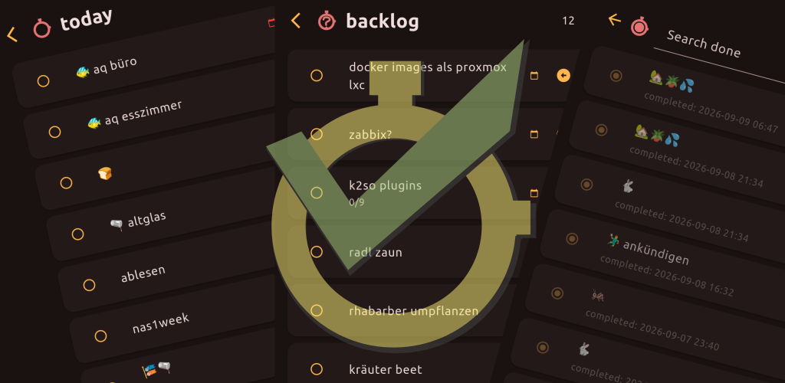

# simple present

A **simple** task management system focused on **present** tasks.

## What it does

SimplePresent helps you manage tasks across three lists: Today, Backlog, and Done. It supports important and in-progress flags, notes, subtasks, scheduled dates and times, and automatic sorting so current work stays in focus.
Perfect for people who like to work on multiple things at once and who can quickly get scattered across many different topics. It helps you keep an overview of your current items and stay focused on what matters now.

Protecting your privacy and keeping control over your data are core goals of SimplePresent. Tasks and settings are stored locally on your device. Use export/import or automatic backups to protect or move your data; the app does not require an account or sync server.

The app also includes a stopwatch, manual time tracking, reminders, swipe actions, and Android notifications.

## Key features

- Three task lists: Today, Backlog, and Done
- Important and in-progress task states
- Notes, subtasks, and scheduled date/time
- Stopwatch and manual time entry
- Per-task worklog with timestamped status, content, time, subtask, and list changes
- Automatic sorting and delayed reordering
- Local storage, export/import, and automatic backups
- Android notifications and desktop notifications
- Reminders and alarms

## Platforms

- Android -> Google Play Store
- Windows -> microsoft Store
- Linux -> Download on GitHub
- Web (Flutter web) via browser - Coming soon (?)

## Local data and backups

SimplePresent stores task data on the device. Export or back up your data using the built-in tools in the app.

## Legal and Privacy

The source code is licensed under the MIT License. The name, logo, icons, and other brand assets are protected separately; see `LICENSE`, `TRADEMARK.md`, and `THIRD_PARTY_LICENSES.md`.

SimplePresent processes task data locally. See `PRIVACY.md` for details.

## Technical Documentation

For internal settings, runtime parameters, and debugging options (including debugWriteLog), see TECHNICAL_README.md.

## footnote

Developed with the kind support of Copilot
